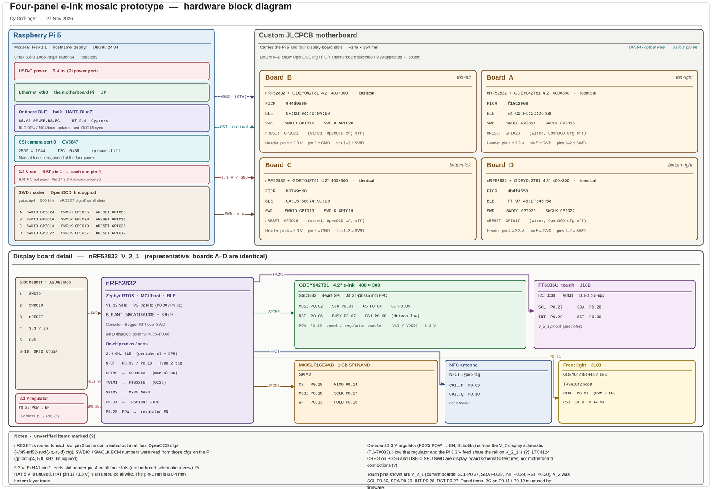
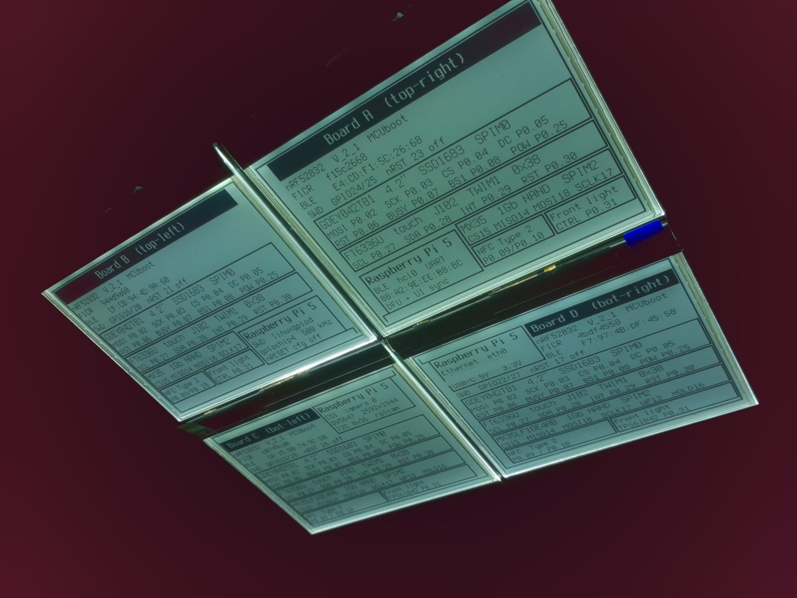

# Four-panel e-ink mosaic prototype

Hardware notes for the lab prototype, gathered on the motherboard Pi on 27 Nov 2026. This directory is documentation and the OpenOCD configs used to talk to the four boards. Firmware images, signing keys, and device credentials stay on the lab host.

The host is a Raspberry Pi 5 Model B Rev 1.1, hostname `zephyr`, running Ubuntu 24.04 (Linux 6.8.0-1068-raspi, aarch64, headless). It sits on a custom JLCPCB motherboard that carries four identical display boards. Letters A–D in these notes are the OpenOCD / FICR names. The motherboard silkscreen is swapped top-to-bottom relative to those letters; see [slot-map.md](slot-map.md) before flashing.

Each display board is **V_2_1**:

- nRF52832, Zephyr RTOS, MCUboot, BLE. Console is Segger RTT. `uart0` is disabled.
- Good Display **GDEY042T81** 4.2" 400×300 panel, SSD1683 controller.
- FT6336U touch controller.
- MX35LF1GE4AB 1 Gb SPI NAND.
- NFC Type 2 tag (the nRF NFCT peripheral, not a reader).
- TPS61042 boost for the GDEY042T81-FL02 front light.
- BLE DFU through MCUboot, and BLE manufacturer-data UI sync, from the Pi's onboard controller (`hci0`, UART, BD address `88:A2:9E:EE:B8:BC`).

An OV5647 on CSI camera port 0 (I2C `0x36`, `rpicam`) faces the four panels and is used to check what is actually on the glass. Reported modes include 640×480, 1296×972, 1920×1080, and 2592×1944.

Pin assignments are in [pinout.md](pinout.md). Which physical corner is which board, and which Pi GPIOs reach it, is in [slot-map.md](slot-map.md).

## Block diagram

Same drawing: [SVG](block-diagram/four_panel_mosaic_block_diagram.svg), [PDF](block-diagram/four_panel_mosaic_block_diagram.pdf). The matplotlib source is [four_panel_block_diagram.py](block-diagram/four_panel_block_diagram.py) (Liberation fonts). The Ethernet line names the host; it does not include a LAN address.

## Mosaic on the panels

The four panels show one 800×600 1-bit image, split into 400×300 tiles with no text crossing a seam:

| | left | right |
|--|------|-------|
| top | B | A |
| bottom | C | D |

The photo is the OV5647 shot of that mosaic on the glass. A lab LAN address that was on board D is covered. The art in this directory uses the words "the motherboard Pi" in that spot.

- [mosaic_800x600.png](mosaic/mosaic_800x600.png) — the 1-bit 800×600 image (MSB leftmost, 1 = white).
- [preview_bezels.png](mosaic/preview_bezels.png) — the same tiles with gaps, at 2×.
- [make_mosaic.py](mosaic/make_mosaic.py) — generator (Terminus, 1-bit, no antialiasing).

## SWD

OpenOCD drives SWD from Pi GPIO through the `linuxgpiod` adapter on `gpiochip4`, at adapter speed 500 kHz. `nRESET` is wired to each slot but commented out in every config. The four configs from the Pi are in [openocd/](openocd/). The usual bring-up command, and the FICR check to run before programming, are in [slot-map.md](slot-map.md).

## Unverified

These items were marked unverified when the block diagram was drawn. They are not confirmed on the running V_2_1 boards.

- The on-board 3.3 V regulator (P0.25 POW to EN through a Schottky) is the TLV70033 from the V_2 display schematic. Whether V_2_1 uses the same part, and how that regulator shares the rail with the Pi 3.3 V feed, is unverified.
- LTC4124 CHRG on P0.26, and USB-C SBU used as SWD, are display-board schematic features, not motherboard connections. Whether they are populated or used on the running V_2_1 boards is unverified.
- The motherboard outline of about 246 × 154 mm is from an earlier board review. It was not re-measured on 27 Nov 2026. The block diagram still shows that figure.
